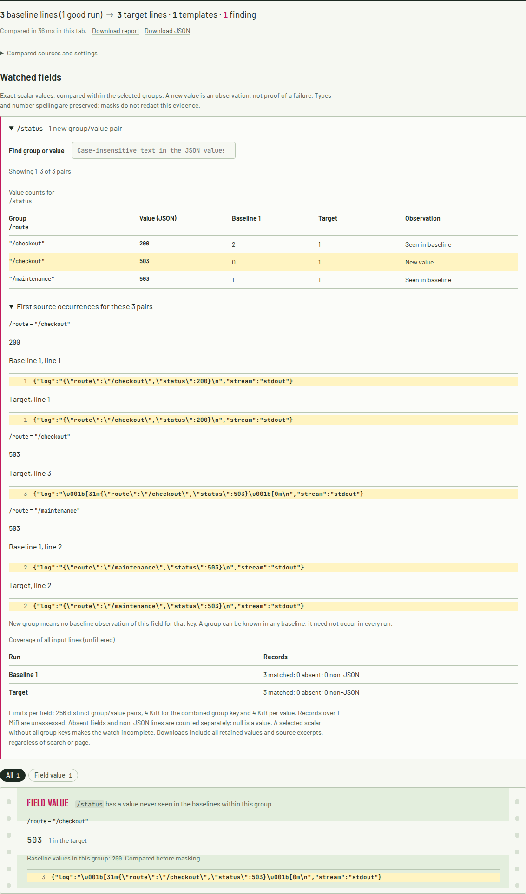

# Watched values must survive a container envelope

A synthetic status change from `200` to `503`, wrapped in ANSI color inside a
Docker `log` string, previously produced exit 0 with a complete `/status` watch.
The unwrapped colored record was counted as non-JSON. An ordinary companion
record was enough to let the incomplete observation set pass the gate.

Two related paths were affected: an embedded trailing newline prevented CRI and
journald prefix recognition, and compact JSON containing `timestamp stdout F`
could be mistaken for an outer CRI header before the JSON string was decoded.

The correction removes terminal styling and trailing CR/LF at the decoded
payload layer, then recognizes the existing prefixes. Object-shaped JSON is
kept intact until its members are decoded. Escaped terminal codes **inside JSON
scalar values** remain exact data. Original log lines and line numbers remain in
the evidence. The same normalization serves ordinary template mining and exact
field watches in native code and WebAssembly.



The same report was inspected in [phone Chromium](../../docs/assets/container-payloads/chromium-375.png),
[desktop Firefox](../../docs/assets/container-payloads/firefox-1440.png) and
[phone Firefox](../../docs/assets/container-payloads/firefox-375.png). On narrow
screens, source lines and the value table retain their horizontal scroll regions.

## Actual command replay

[Before](results/before.json) and [after](results/after.json) record 26 calls to
the real CLI. All inputs are **synthetic**, constructed with JSON serialization;
no Docker daemon, production incident or remote service is involved. The
baseline is source `7188302`; the replay retains input sizes and SHA-256 digests,
exit statuses, complete watched-field records and hashes of the full reports.

| Controlled case | Previous behavior | Corrected behavior |
| --- | --- | --- |
| 19 new-value cases, pooled or grouped | 13 false clean exits; 2 incorrectly incomplete; 4 working controls | All 19 identify the new `503` with original source evidence |
| 3 rate comparisons | Only 50 of 100 records counted; unchanged 4% observed rate, exit 0 | All 100 counted; 2% to 27% error rate, exit 1 |
| Styled duplicate/malformed field, 2 cases | Damaged payload skipped as non-JSON; watch called complete | Incomplete watch, original problem line retained, exit 2 |
| Escaped terminal codes within a scalar | Styled target not observed | Exact scalar preserved; unchanged comparison, exit 0 |
| Ordinary unchanged logs | Clean comparison | Byte-identical full report |

The new-value cases include SGR color, OSC hyperlinks with both terminators,
CRI and journald headers, their colored forms, and plain/timestamp controls.
Compact envelopes use LF; spaced envelopes use CRLF. Grouped cases include a
known maintenance `503`, which must not hide checkout's first `503`.

For the rate cases, 50 unstyled records contain two errors in both runs. Fifty
wrapped records change from no errors to 25 errors. Independently counting these
constructed records gives 2/100 and 27/100. These are observed counts, not an
estimate of a real service's error rate or a causal finding.

```sh
cargo build --locked --release
python3 studies/container-payloads/replay.py target/release/logdelta /tmp/logdelta-container-after after
```

Use a new output directory. It receives every input and full JSON report; the
command emits the capture on stdout. For the baseline, pass a binary built from
`7188302` and `before`. The script uses only Python's standard library and can
also check a separately installed crate.

Four representative [inputs](inputs) are retained directly for browser checks.
The browser scenarios compare and download their evidence offline in Chromium
and Firefox at desktop and phone widths. Integer counts and source records must
match native captures exactly; floating-point scores are compared at 12
significant digits, as in the existing rate comparison checks.

## Limits

This handles the already-supported single Docker envelope and recognized
single-line prefix forms. It does not reconstruct CRI partial records, join
multiline JSON events, recursively decode arbitrary nested log formats, or
prove that all relevant events exist in the supplied logs. Unrelated plain text
and missing watched fields retain their existing coverage semantics. The
source correction is unreleased; no registry release or hosted deployment is
included.
