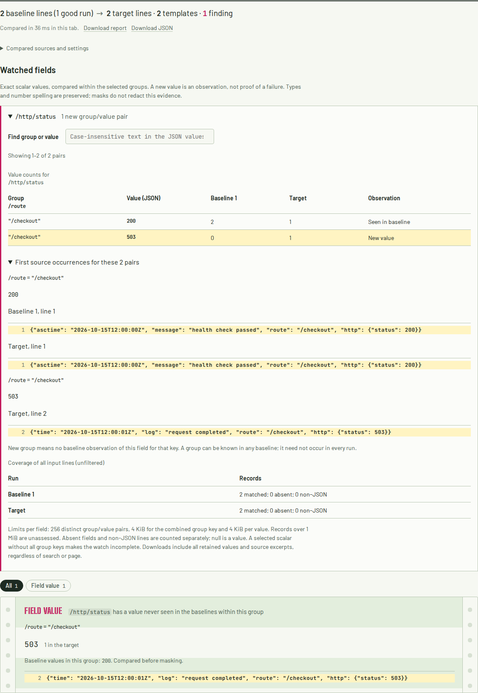

# An application message is not a transport wrapper

A JSON event with `log`, `time`, and an outer `http.status` was treated as a
Docker envelope. Its message replaced the entire object. A `503` outside the
message disappeared, and an ordinary companion `200` was enough for an exact
watch to report complete coverage and exit 0. If the message itself looked like
JSON, the watch could select the message's `200` instead of the event's `503`.

The baseline is source
`fad282595b202c1be1153015ec0a52fb9061f09a`, rebuilt before capture.
The correction shares one conservative detector between template mining and
exact watches. It unwraps a string `log` only with a `stdout`/`stderr` stream and
no keys beyond `log`, `stream`, `time`, and `attrs`. Optional `time` is a string;
optional `attrs` maps strings to strings. Additional application fields preserve
the whole event. Missing timestamp/attributes remain supported for copied
wrappers. Ambiguous wrapper members and repeated attribute names cannot establish
complete exact coverage. The original source record stays in the report.

```text
Application JSON: log + time + http.status -> keep object -> watch http.status
Docker wrapper:  log + stdout + time     -> decode log  -> watch payload
Duplicate wrapper metadata              -> unknown     -> exit 2
```

## Native formatter output and CLI replay

[`capture_logger.py`](capture_logger.py) invokes Python's real logging handler
with **Python JSON Logger 4.2.0**, using its supported
[`rename_fields`](https://nhairs.github.io/python-json-logger/latest/quickstart/#renaming-fields)
option to rename `message` to `log` and `asctime` to `time`. Each run mixes one
ordinary producer with one renamed producer. The timestamps and HTTP outcomes
are constructed and fixed for reproducibility. These are controlled logging
calls, not production traffic or a Docker daemon capture. The
[formatter receipt](results/logger.json) hashes all four committed inputs.

The wrapper control follows Docker's
[documented json-file shape](https://docs.docker.com/engine/logging/drivers/json-file/)
and its [`JSONLog` metadata fields](https://github.com/moby/moby/blob/master/daemon/logger/jsonfilelog/jsonlog/jsonlog.go).
The wrappers are constructed locally around captured events; no active Docker
log storage is accessed.

The [before](results/before.json) and [after](results/after.json) captures run
19 actual CLI comparisons. They retain each input's bytes, SHA-256 and record
count, command flags, exit status, complete watched-field evidence and full
report hash. The replay also saves every full input/report to the selected
temporary directory.

| Controlled case | Baseline | Corrected behavior |
|---|---|---|
| 8 application novelty cases: renamed producers, JSON-looking messages, application stream fields | 7 false-clean exits; 1 incomplete grouped watch | All 8 retain the outer `503`, original line and exact group |
| 4 genuine Docker controls, including wrapped native events | New status found | New status found, all records counted |
| Known-value rate change | Only 50/100 records assessed; observed 4% in both runs; exit 0 | 100/100 records assessed; 2% to 27%; exit 1 |
| 5 ambiguous wrapper/attribute cases | Duplicate log/stream rejected; time/attrs ambiguity could still be accepted | All incomplete, original problem line retained; exit 2 |
| Unchanged application input | Exit 0, one producer omitted | Exit 0, both producers counted |

This study establishes behavior on these controls. It does not measure the
prevalence of renamed logging fields or imply a production incident.

## Artifacts, other formats and offline use

The [public-log replay](results/corpus.json) checks the existing hash-pinned
cache: 536 input files, 429,474,908 bytes, 264 Kubernetes comparisons and 16
Loghub template reports. All 280 complete reports, stderr streams and exit
statuses are byte-identical before and after. This is a compatibility replay
on retained inputs, not a new collection or held-out accuracy study. The
[26 prior container-payload controls](results/container-controls.json) also
retain identical captures against this study's rebuilt baseline.

All [19 full WebAssembly reports](results/wasm.json) match native output:
integers, text and source evidence exactly, floating-point scores at 12
significant digits. The packaged crate's
[25 runtime/manifest/lock files](results/artifacts.json) match the workspace.
Separate Rust 1.91 and 1.85 crate installations each reproduce the entire
19-case identity replay and all 26 container controls. The full clean native
suite passes 230 checks on both toolchains, including the documentation example;
the library-only build passes 148 checks. The clean web build passes lint,
types and 83 checks.
The [verification receipt](results/verification.json) also records three
WebAssembly-wrapper checks and all 20 build-configuration cases, including
identical engine bytes across distinct checkout/output paths and preservation
of the prior engine after injected compilation/metadata/artifact failures.

The existing 128 Chromium/Firefox workflows pass. Four final identity workflows
open fresh contexts at 1440/375px, disconnect before the first new comparison,
inspect the source evidence and compare complete downloaded field ledgers with
native captures. The initial Chromium runs counted a local `blob:` download as
a network request; that assertion was corrected and all four workflows rerun.
The final captures contain zero HTTP requests or page errors after disconnect.
The [39 served production files](results/served.json) match the clean build.



All four captures were inspected. Tables and source lines keep their horizontal
scroll regions at phone width:

| Engine | Desktop | 375 px | Download observations |
|---|---|---|---|
| Chromium | [Capture](../../docs/assets/envelope-identity/chromium-1440.png) | [Capture](../../docs/assets/envelope-identity/chromium-375.png) | [Desktop](results/chromium-1440.json), [phone](results/chromium-375.json) |
| Firefox | [Capture](../../docs/assets/envelope-identity/firefox-1440.png) | [Capture](../../docs/assets/envelope-identity/firefox-375.png) | [Desktop](results/firefox-1440.json), [phone](results/firefox-375.json) |

A [100,000-record throughput control](results/throughput.json) retains six
serial alternating CLI calls on 13.1 MB of genuine-shaped Docker records.
All template reports are byte-identical. Median wall times were 0.294 seconds
for the baseline and 0.328 seconds for the correction on the shared WSL2 host.
The decoder performs additional ambiguity validation; this is not a throughput
improvement claim, and host activity is not controlled.

## Reproduce

From the repository root, build the source CLI and replay it:

```sh
cargo build --locked --release
python3 studies/envelope-identity/replay.py target/release/logdelta /tmp/envelope-after after
```

Use a new output directory. To capture the baseline, use a binary built from
the revision above and pass `before` instead of `after`. The replay itself uses
only the Python standard library. Regenerating the native formatter inputs
additionally requires the pinned logger:

```sh
uv run --python 3.14 --with python-json-logger==4.2.0 python studies/envelope-identity/capture_logger.py
```

The built engine and installed-package workflows can be checked separately:

```sh
cd web && npm ci && npm run build
cd ..
node studies/envelope-identity/replay-wasm.mjs web/src/generated/logdelta.wasm /tmp/envelope-after
python3 studies/envelope-identity/throughput.py /path/to/baseline/logdelta /path/to/current/logdelta /tmp/envelope-timing
```

Browser captures use `LOGDELTA_ENVELOPE_SHOTS=/path/to/output` with
`npx playwright test tests/browser/envelope-identity.spec.mjs` from `web/`.

## Boundaries

This is a constrained content detector, not provenance authentication. An
application object that exactly copies the accepted Docker wrapper shape is
indistinguishable from that wrapper and its `log` is decoded. A record with an
unknown stream, additional top-level fields, or unsupported metadata types is
an ordinary object: pointers address its outer fields. There is no implicit
search at multiple depths and no recursive transport decoding. Existing CRI,
journald, styling, mixed-event missing-field and bounded-ledger policies remain
in effect.

The correction and evidence are public at
[`95ff304`](https://github.com/antonsoo/logdelta/commit/95ff3045c9624eafd03cd048ace9175733d37326).
The [publication receipt](results/publication.json) verifies the remote branch
identity and all 38 changed files against pinned public raw bytes. Locally built
packages retain version 0.3.4; no registry release or manual hosted deployment
is included.


## Public browser follow-up

The [fresh public replay and clean-build deployment](hosted.md) finds the
older live engine still hiding both native formatter failures, then verifies
the existing correction in the actual public page. It retains canonical build
bytes, 76 full downloaded report comparisons after disconnecting, and desktop/
phone before-and-after screenshots. This later static deployment does not change
the source-only scope of the original publication receipt above or release a
new crate.
