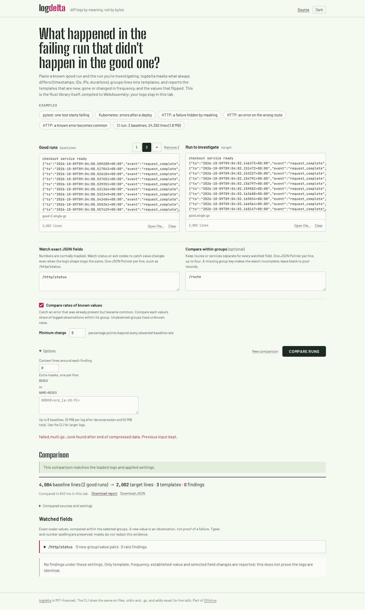
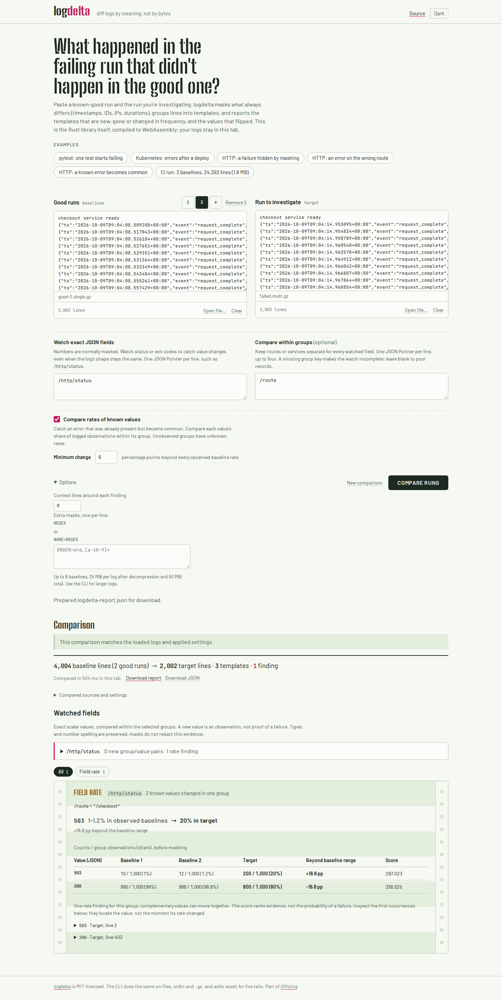

# Clean artifact verification

The browser/runtime correction is commit
`0066277f86fa5f02998689832aead2228128a14b`. A fresh `git archive` of that
commit was installed and built separately from the working checkout.

| Gate | Observed result |
| --- | --- |
| Locked native tests, all targets/features | 230 passed |
| Rust 1.85 minimum, locked all-target/all-feature tests | 230 passed |
| Rust formatting, clippy with warnings denied | Passed |
| Library without default CLI features | Built |
| WASM wrapper native tests, target clippy and formatting | Passed; 3 wrapper tests |
| Node 24.21 fresh install, types, ESLint, unit tests | Passed; 96 unit tests |
| Production Chromium/Firefox suite | 136 passed; process exit 0 |
| Real compiler/configuration/rebuild matrix | 20 cases passed |
| Packaged crate | 106 files; fresh installed CLI replay passed |
| Engine source in packaged crate | All 23 source files byte-identical |
| Fresh and working production sites | All 39 files byte-identical |
| GNU gzip versus actual WASM C ABI | 17 captures; accepted bytes match GNU gunzip |
| Native single-member versus six-member reports | Complete results identical, exit 1 with rate findings |
| Corrupt/truncated/junk native targets | Exit 2; no partial JSON report |

The compiler was Rust 1.91.0; minimum-version verification used 1.85.0.
These are compatibility and artifact checks, not performance benchmarks.
No package-registry release or tag was made. The CLI's existing streaming
multi-member behavior was preserved.

[Artifact hashes](results/artifacts.json), [installed replay](results/installed-wasm.json),
and [the compiler matrix](results/build-matrix.json) retain the executable and
source boundaries. The production module is 1,318,570 bytes, SHA-256
`7e480e9629640ae39aa96234057b98877aa5339a22a70e97129413e80ea2843c`.
The matrix's deliberate cfg probes and stale-module controls have different
hashes; they are temporary verification modules, not deployed assets.

## Actual browser work

Both phases ran Chromium 153.0.8010.12 and Firefox 155.0 at 1440 and 375 pixels.
The earlier archived page rejected the six-member target, preserved its previous
input, and downloaded the unchanged prior report: 8 actual saved reports.
The clean corrected page opened all members and saved 64 actual downloads,
including the raw engine JSON as well as portable reports. The retained
[before](results/browser-before/browser.json) and
[after](results/browser-after/browser.json) receipts list their hashes.

Each corrected context checks all four corruption/truncation controls, both
expanded/decoded limits, cross-member Unicode boundaries, malformed UTF-8
provenance, literal U+FFFD, all-three-input multi-member comparison, independent
baseline/target workers, Cancel, typing, reset, and offline recovery. All four
contexts recorded zero HTTP requests after warm-up, zero page errors, zero
unhandled rejections, zero CSP violations, and no page overflow. Those are
specific workflows, not a general audit of every possible log.

Every captured screenshot was opened and visually inspected. The 375-pixel rate
table scrolls within its card, with its existing scroll instruction; the page
itself does not overflow.

| Earlier rejection | Corrected complete rate evidence |
| --- | --- |
|  |  |

[Chromium phone layout](../../docs/assets/gzip-after-mobile.png) and
[Firefox phone layout](../../docs/assets/gzip-after-firefox-mobile.png).

Public-byte and logged-out browser verification are recorded separately after
publication. A source commit or successful local build alone is not a public
workflow check.
