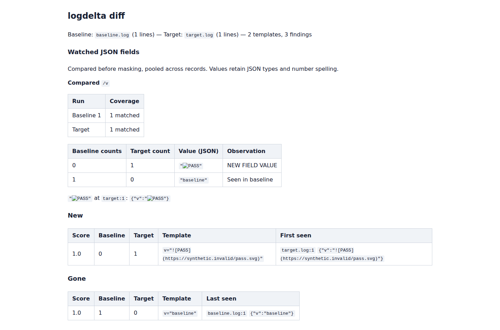
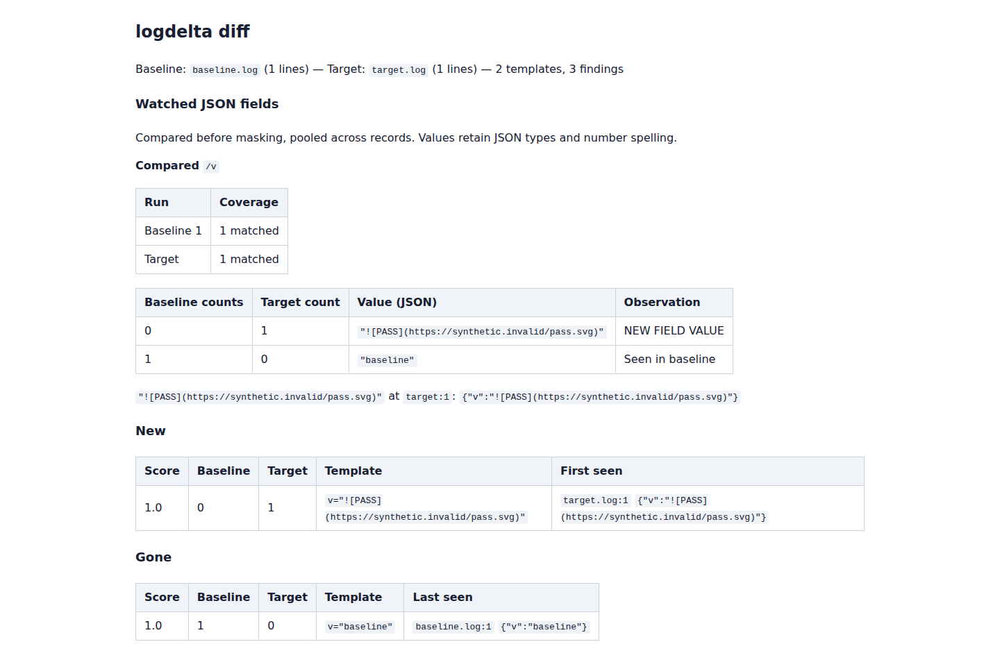

# Keep log evidence literal in Markdown reports

`--markdown` output is meant for a CI summary or review comment. Recorded text
must remain evidence when that report is rendered. At baseline
`3823694b53abe9d36f05ac719b5d519e51a6eaa2`, a log line containing backticks
could close its code span and produce image/link markup. Exact-field reports
had a separate problem: HTML `<code>` wrappers still allowed Markdown syntax
inside them. Even entity-escaped email addresses could become GFM autolinks.

The correction uses actual Markdown code spans, with delimiters longer than
every backtick run in the displayed text. Padding preserves boundary backticks
and significant spaces. Table cells escape pipes for GFM's table parser;
paragraph code spans retain their pipes without adding backslashes. The same
helpers handle ordinary findings, novel values, field/group labels, known-value
rates, incomplete evidence and source paths. Existing full-block fences remain.

## Actual CLI reproduction

Twenty synthetic workflows run through the built CLI and GitHub's
[cmark-gfm reference renderer](https://github.com/github/cmark-gfm/tree/27d942c8b0a62d192f616e5bf3578f4b6a89e180),
version `0.29.0.gfm.13`. The [GFM code-span rules](https://github.github.com/gfm/#code-spans)
define delimiters and padding; [table rules](https://github.github.com/gfm/#tables-extension-)
require pipe escaping within cells, including code spans. These checks target
GFM as parsed by that reference, not every Markdown implementation.

| Observed across 20 complete reports | Before | Corrected |
| --- | ---: | ---: |
| Reports preserving expected literal evidence and structure | 3 | 20 |
| Input-created image elements | 37 | 0 |
| Input-created links | 12 | 0 |
| Matching JSON outputs | 20 | 20 |
| Matching terminal outputs | 20 | 20 |

The counts come from actual generated reports, not isolated escape-function
examples. Cases cover ordinary/gone findings, a novel token value, exact JSON
values, grouped rates, malformed evidence, headers and filenames, multiple
backtick lengths, pipes after backslashes, entities, Unicode and clipping.
Every JSON and terminal report retains the same bytes and exit status.

The [before](results/before.json) and [clean corrected](results/after.json)
receipts retain per-case outcomes and output hashes. A small complete example
is retained as [before Markdown](rendered/before.md), [before HTML](rendered/before.html),
[corrected Markdown](rendered/after.md) and [corrected HTML](rendered/after.html).

The capture checks rendered code text against the JSON report's recorded
evidence, table column counts, nested elements, and generated links/images.
The parser runs with table, autolink, strikethrough and tagfilter extensions;
`--unsafe` preserves the old HTML wrappers so their failure is exercised.
No report is posted to GitHub and no external image is fetched.

## Reproduce

Build the CLI with `cargo build --locked`. Build the pinned renderer separately:

```sh
git clone https://github.com/github/cmark-gfm.git /tmp/cmark-gfm
git -C /tmp/cmark-gfm checkout 27d942c8b0a62d192f616e5bf3578f4b6a89e180
cmake -S /tmp/cmark-gfm -B /tmp/cmark-build -DCMAKE_BUILD_TYPE=Release
cmake --build /tmp/cmark-build -j 4
python3 studies/markdown-literals/capture.py --binary target/debug/logdelta --cmark /tmp/cmark-build/src/cmark-gfm --out /tmp/logdelta-markdown-after --check
```

The renderer is fetched and built for verification; it is not a Logdelta
dependency. The capture writes its synthetic inputs, Markdown, HTML, JSON,
terminal output and receipt into the requested directory. An installed binary
can be passed with `--binary`. Baseline runs should omit `--check` to retain
the expected disagreements.

## Browser inspection

`browser.mjs` loads the actual reference-rendered HTML in offline Chromium and
Firefox at 1440 and 375 pixels. A small local stylesheet makes the captured
reports readable; this is not a screenshot of GitHub's hosted renderer.
The 80 corrected report loads preserve code text and issue no requests. Eight
baseline loads of two affected reports attempt eight image requests, all
prevented by offline mode and routing. The two retained screenshots were opened
for inspection. No web application source is changed.

Before: recorded image syntax becomes a broken image labelled PASS.



Corrected: the complete recorded syntax remains visible as evidence.



The [browser receipt](results/browser.json) records HTML hashes, rendered-code
text hashes and request attempts for each engine, viewport and case.

After `npm ci --prefix web`, run with before/after capture directories:

```sh
node studies/markdown-literals/browser.mjs /tmp/logdelta-markdown-before /tmp/logdelta-markdown-after /tmp/logdelta-markdown-browser
```

Only source and local artifacts are changed. Package version 0.3.4, registry
releases, tags and the hosted demo are outside this change.

## Clean and installed verification

A clean archive of production commit
`34db177524747b621408456a848bdc32ba31f86a` passes formatting, Clippy with all
targets/features and warnings denied, all 215 tests including the doctest,
a release build and Cargo's package verification. The build uses locked,
offline dependencies and Rust 1.91.0. All 35 selected source, test and replay
inputs match the exercised checkout.

The 218,952-byte crate has SHA-256
`aad516a75f237047f57b8ae0c030f5db3bd9463774c56826bf172649fde3a64b`.
All 102 packaged files match the extracted installation source; Cargo's
normalized manifest is accounted for separately. The remaining files match
the clean archive and checkout, including the original manifest.

A separate offline installation compiled that packaged source with the
declared minimum Rust 1.85.0. Its complete 20-case replay matches the clean
release and working-tree replay: Markdown, reference-rendered HTML, JSON,
terminal output and exit status. Binary hashes differ by compiler/profile.
The [artifact receipt](results/artifacts.json) retains input/package hashes,
binary hashes, renderer provenance and the validation scope. Execution was
on Linux/WSL2; the reports were not posted to a hosted review or CI system.
