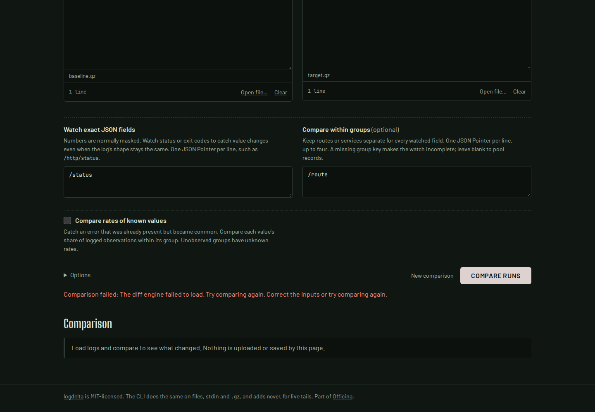
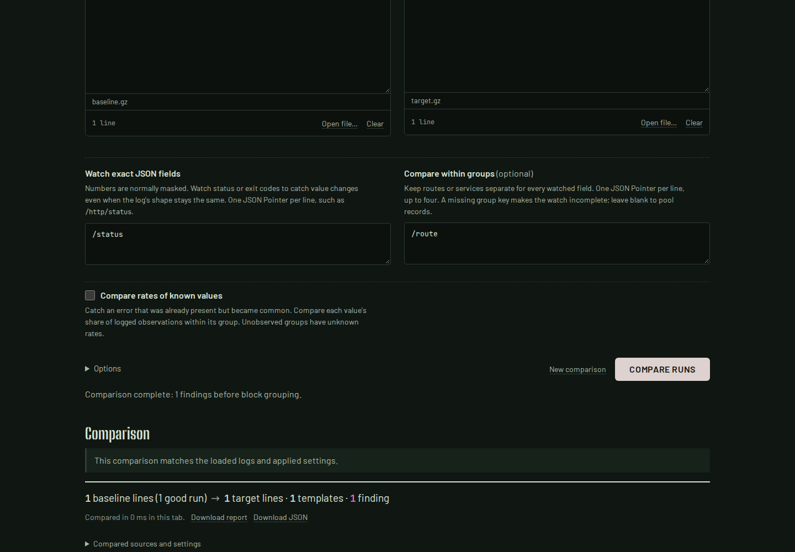

# Recreating the diff worker offline

The production build at `509bd44ce04311f49238558f4bb0a09c864993dc` could compare
offline while its original worker remained alive. **New comparison** terminated
that worker; the next comparison requested the worker script and WebAssembly
again. Chromium failed to load the worker in the retained replay. Firefox
succeeded through its cache but still requested both assets. Offline reuse thus
depended on browser caching after ordinary workspace actions.

The [before receipt](results/browser-before.json) contains the original reports,
observed requests, worker creation/termination counts and screenshots at 1440px
dark and 375px light. Inputs are synthetic JSON logs imported as actual gzip
files, watching `/status` within `/route` groups.



## What is retained

The worker program is now included in the page's JavaScript using Vite's
[inline worker import](https://vite.dev/guide/features.html#import-with-query-suffixes).
The page's CSP permits local `blob:` workers while retaining `connect-src 'self'`.
The WebAssembly asset keeps its content fingerprint and is fetched by the first
worker. After a successful comparison, that worker returns the exact module bytes
alongside its result. The interface retains those bytes in memory after validating
the report, and supplies them only when constructing a replacement worker.

```text
First worker:       fingerprinted URL -> bytes -> hash + instantiate -> comparison
                                          |
                                          v
Page memory:                      successful module bytes
                                          |
Cancel / reset:    terminate worker        |  logs and WASM memory released
                                          v
Replacement:        bundled worker -> same bytes -> hash + instantiate -> comparison
```

Each replacement calculates the SHA-256 of the bytes it actually instantiates;
the previous report's hash is not copied as a claim about a new execution.
Cancelled workers and queued replies cannot update a later report or replace the
retained module. Failed downloads and modules that do not initialize are not
retained, so restoring valid assets allows retry in the same page.

The retained buffer contains executable code, not log data or a worker's linear
memory. Termination still interrupts synchronous WASM work. No service worker,
Cache Storage, IndexedDB or log persistence was added. This guarantee starts
after a completed comparison in the **production build**. Cold page loads,
reloads, example downloads and the development server still need site assets.

## Replay

[`replay.mjs`](replay.mjs) runs the actual production WASM in Chromium and Firefox
at both screen sizes. After the initial comparison, it switches the browser
offline, starts a new comparison from local gzip files, then cancels, edits and
resets active comparisons. It holds real completed worker replies only to make
the cancellation order deterministic, then releases them after cancellation to
check that they cannot replace the current report.

Each repaired flow creates six workers and explicitly terminates five, including
the initially loaded worker. All subsequent comparisons complete with no HTTP
requests and the same executed-module hash. The replay retains 20 full reports;
[`check_native.py`](check_native.py) compares their complete results with an
installed native executable using identical options. Both one-line and edited
two-line targets match.

```sh
cd web
npm ci
npm run build
npm run preview -- --host 127.0.0.1 --port 4324 --strictPort
# In another terminal, from the repository root:
node studies/offline-lifecycle/replay.mjs \
  http://127.0.0.1:4324/logdelta/ after /tmp/logdelta-offline
python3 studies/offline-lifecycle/check_native.py --binary target/release/logdelta \
  --browser /tmp/logdelta-offline/browser.json --out /tmp/logdelta-offline/native.json
```

The native command assumes a previously built or installed binary; use its path
with `--binary`. Run `cargo build --locked --release` to build one from source.
The `before` replay mode records either browser outcome rather than treating
Firefox's successful cache reuse as a reproduced failure.

This is local source/build evidence. It does not assert that a registry package
or the hosted demo contains the change.

## Clean-build verification

A fresh archive of `6d3915db8ad844569bafe318cf5a5b8cd691c70e` passed `npm ci`,
typecheck, lint, 83 unit tests, the production build and all 124 browser checks
on Node 26.7.0 and Rust 1.91.0, WSL2 Linux. The WASM crate also passed formatting,
Clippy and its three tests. The browser suite includes initial HTTP failures,
invalid/incompatible modules and retry, startup failures, stale replies, and the
two-build fixture which verifies that an old cached module cannot identify a
new build. The clean build's WASM is byte-identical to the module verified in the
[text-integrity package/build study](../text-integrity/README.md).

The [repaired browser receipt](results/browser-after.json) retains all four
offline flows and 20 exported reports. Their complete results match the
previously installed native package ([parity receipt](results/native-parity.json)).
All report engine hashes match the actual clean-built module. There were no
page errors, unhandled rejections, off-origin requests, CSP violations,
horizontal overflow or accessibility violations in these flows. Local blob
worker creation is recorded separately from HTTP requests.

All 39 files served by the preview match the clean build byte for byte, and 69
source/configuration files match the tested archive. The
[artifact receipt](results/artifact-checks.json) lists every hash and command.
All before/after screenshots were inspected, including narrow layouts in both
browsers.



Additional repaired captures: [Chromium 375px](../../docs/assets/offline-lifecycle/chromium-375-after.png),
[Firefox 1440px](../../docs/assets/offline-lifecycle/firefox-1440-after.png),
[Firefox 375px](../../docs/assets/offline-lifecycle/firefox-375-after.png).
