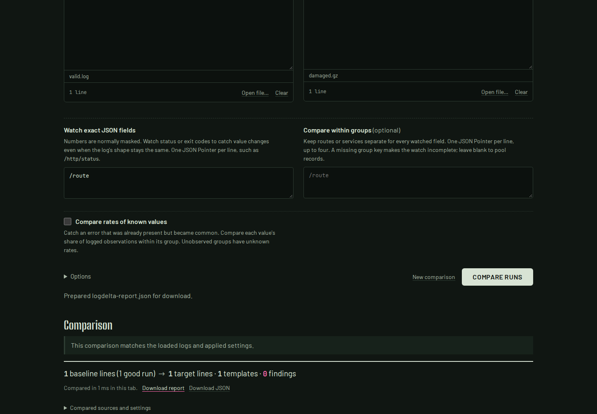
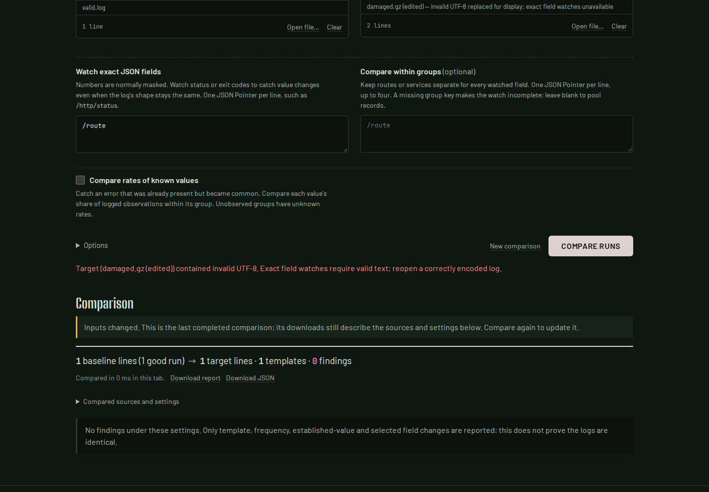

# Exact watches need intact decoded text

An invalid source byte and a real replacement character can decode to the same
string. Before this repair, comparing UTF-8 `{"route":"caf\uFFFD"}` with the
bytes `7b 22 72 6f 75 74 65 22 3a 22 63 61 66 ff 22 7d 0a` reported an exact
`/route` watch as complete, with no new values and exit 0. The native reader and
browser both replaced the invalid byte, losing the distinction before comparison.

These are synthetic inputs demonstrating a decoding failure, not a claim about
the frequency of damaged production logs. The baseline is source commit
`67caad720f297a09a677c056241f74b8e2190940`.

## Behavior

| Input and operation | Before | Repaired |
| --- | --- | --- |
| Malformed UTF-8 or BOM-marked UTF-16, exact watch | Could report complete and exit 0 | Native error with source name, exit 2, no comparison JSON |
| Same damaged file, ordinary template comparison | Replacement decoding | Same comparison result |
| Actual, valid encoded U+FFFD | Exact value allowed | Still allowed |
| Browser import with replacements | Lost decoding provenance | Warning in input and report provenance |
| Exact browser watch after editing that import | Could hide the original loss | Blocked until replaced by valid input; previous report stays stale |

Strict validation applies to the whole input used in an exact watch, including
bytes outside the watched field. It covers files, stdin, gzip, both UTF-16 byte
orders, truncated sequences, lone surrogates and split stream headers. Existing
tolerant `read_lines` and `open_source` library APIs keep their behavior;
`read_lines_exact` is available when callers need the strict path. `diff_runs`
selects it for watched fields. `diff_lines` receives strings and cannot determine
whether its caller previously discarded source bytes.

The browser retains `decoding_loss` on an ordinary report's affected source.
Editing displayed text cannot recover the original bytes, so it retains the
warning. A valid replacement file or an explicit clear creates a fresh source.
Pasted text cannot attest to bytes that were decoded elsewhere.

## Retained native replay

[`replay.py`](replay.py) supplies nine synthetic encodings as files, stdin and
gzip, and also damages the baseline. The 44 cases retain the actual bytes as
base64, their SHA-256, binary SHA-256, exit codes, diagnostics and complete JSON
reports in [`results/before.json`](results/before.json) and
[`results/after.json`](results/after.json).

All 24 malformed-input cases previously claimed a complete exact watch: 18 exited
0 and six odd-tail cases exited 1 for an ordinary new line. All 24 now exit 2
without a report. The other 20 valid-input cases are unchanged. Every ordinary
comparison's full result, exit code and diagnostic is unchanged across all 44
cases. Expected native outcomes increased from 20/44 to 44/44.

```sh
cargo build --locked --release
python3 studies/text-integrity/replay.py --binary target/release/logdelta \
  --out /tmp/text-integrity.json --expect-correct
```

[`results/streaming-compatibility.json`](results/streaming-compatibility.json)
also retains the existing [streaming-input replay](../streaming-inputs/README.md):
172/172 checks pass on both binaries and all reference outputs are unchanged.
That replay includes 32,000 lines from 16 Loghub raw-log samples and the existing
captured HTTP rate scenario. The Loghub files came from the local cache; each was
checked against the existing pinned source manifest, including length and SHA-256
([receipt](results/corpus-inputs.json)). This is compatibility evidence, not an
accuracy benchmark or a new download of that corpus.

## Browser replay

[`check_browser.mjs`](check_browser.mjs) imports actual gzip files and compares
them with production WebAssembly. The before receipt and screenshot retain the
misleading complete exact report:



After repair, the replay covers UTF-8, UTF-16LE and UTF-16BE in Chromium and
Firefox at 1440px dark and 375px light. Each flow checks the ordinary report,
blocked exact watch after editing, unchanged stale download, valid U+FFFD
recovery and a damaged baseline. Checks run offline **after loading the worker**.
They do not cover a fresh worker after New comparison; that separate lifecycle
failure was reproduced during this study and remains a distinct repair.

The [clean-build browser receipt](results/browser-after.json) retains all 12
flows, complete downloads and screenshot hashes. No page errors, off-origin
requests, CSP violations, horizontal overflow or accessibility violations were
observed in those flows. Screenshots were inspected at both sizes in both
browsers; the error and stale-report notice remain readable on narrow screens.



Additional captures: [Chromium 375px](../../docs/assets/text-integrity/chromium-375-after.png),
[Firefox 1440px](../../docs/assets/text-integrity/firefox-1440-after.png),
[Firefox 375px](../../docs/assets/text-integrity/firefox-375-after.png).

```sh
cd web
npm ci
npm run build
npm run preview -- --host 127.0.0.1 --port 4322 --strictPort
# In another terminal, from the repository root:
node studies/text-integrity/check_browser.mjs \
  http://127.0.0.1:4322/logdelta/ after /tmp/text-integrity-browser
```

This study concerns local source and built artifacts. It does not establish that
a registry package or the hosted demo contains the repair.

## Clean package and build verification

A fresh archive of `509bd44ce04311f49238558f4bb0a09c864993dc` was checked on
WSL2 Linux with Rust 1.91.0, Rust 1.85.0 and Node 26.7.0. Rust formatting,
Clippy with warnings denied, 213 native tests and one doctest passed. The minimum
supported Rust toolchain passed the same native tests. The WASM crate passed its
formatting, Clippy and three tests; the web package passed a fresh `npm ci`,
typecheck, lint, 81 unit tests, production build and all 124 Chromium/Firefox
workflow checks. The separate WASM build verification exercised configuration,
failure recovery and identical output from distinct checkout paths
([complete results](results/wasm-build.json)).

`cargo package --locked` was verified, then the packaged source was installed
into an isolated prefix. The installed executable passed all 44 cases; every
full report and diagnostic matched the source replay
([installed receipt](results/installed.json)). All 40 files served by the local
production preview byte-matched the clean build, and 69 source/configuration
files matched the tested archive. Exact commands, hashes and scopes are retained
in [artifact-checks.json](results/artifact-checks.json).
